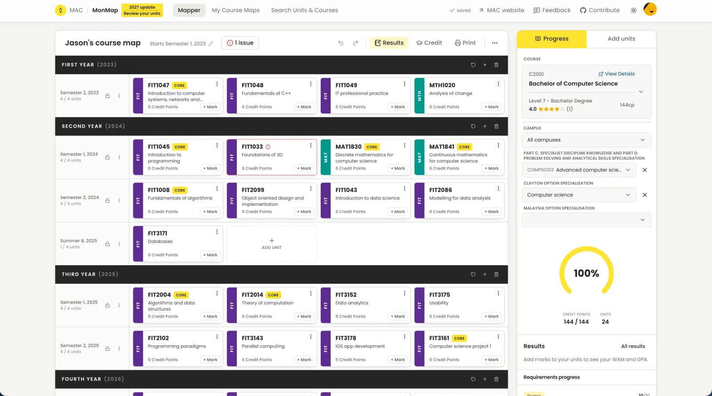
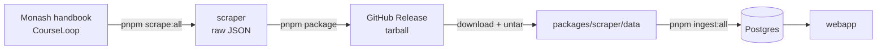

<div align="center">

# MonMap

**A course planner for Monash students, built by the [Monash Association of Coding](https://monashcoding.com).**

Built to replace [MonPlan](https://monplan.apps.monash.edu), which Monash sunset on 2 June 2026.

[](https://monmap.monashcoding.com)
[](https://github.com/monashcoding/monmap/issues)
[](https://docs.google.com/forms/d/e/1FAIpQLSfEMCU4OCItlK6DGgIXTovH7_sPSW6mZtMaPGf1OCUQW_43kg/viewform)

[](CHANGELOG.md)
[](https://github.com/monashcoding/monmap/actions/workflows/deploy.yml)
[](LICENSE)




</div>

## Overview

MonMap lets you drag units onto a year-by-year grid and see, in real
time, whether your plan works. It checks prerequisites and offerings
against the Monash handbook, flags what doesn't fit, shows what your
course requirements still need, and keeps a running WAM. Every unit,
course and major also has its own page with student reviews and a
requisite map.

No account is needed. Without one, your plan stays in your browser.
Sign in with your Monash Google account to keep several plans and sync
them across devices.

## Features

| | |
| --- | --- |
| 🗓️ **Planner** | Drag units onto semesters, with undo, slot-fit hints and suggestions from your course. Works on touch screens with long-press drag. |
| ✅ **Requirement checks** | Prerequisites, offerings, cross-year rules and honours variations, checked live against the handbook. |
| 🎓 **Double majors and minors** | Plan up to two majors or minors of each kind, with a campus preference and overlap detection. |
| 📊 **WAM tracking** | Enter grades as you go and see your running WAM. |
| ⭐ **Student reviews** | Rate units, courses and majors on teaching, content, assessment, difficulty and workload. Reviews show initials only. React with emoji and sort by reactions. A classifier screens out abuse, spam and personal details ([how it works](docs/reviews.md)). |
| 📚 **Handbook pages** | A page for every unit, course and area of study from 2020 to 2027, with a requisite map of what each unit needs and unlocks ([details](docs/handbook-pages.md)). |
| 🔎 **Search** | One sortable search over every unit, course and area of study. |
| 📤 **Export** | Download a plan as CSV or print it. |

If something looks wrong for your course, read the code, file an
issue, or send a PR. For what changed in each release, see the
[changelog](CHANGELOG.md).

## Contributing

PRs welcome. If a unit, requisite or course renders wrongly, that is
almost always a bug worth filing. Open an
[issue](https://github.com/monashcoding/monmap/issues) with the unit
code and what you expected. For non-code feedback, use the
**Feedback** form linked in the app.

## Development

### Repository layout

A pnpm workspace with four packages:

| Package | Does |
| --- | --- |
| [`packages/webapp`](packages/webapp) | The Next.js app: planner, handbook pages, reviews, search. |
| [`packages/db`](packages/db) | Drizzle schema, migrations and the shared Postgres client. |
| [`packages/scraper`](packages/scraper) | Fetches handbook data from CourseLoop into `packages/scraper/data`. |
| [`packages/ingest`](packages/ingest) | Loads the scraped data into Postgres. |



The handbook data is published as a tarball on
[GitHub Releases](https://github.com/monashcoding/monmap/releases), so
you don't need to scrape to run a working instance.

### Prerequisites

- Node ≥ 22 (CI and the Docker image use Node 22)
- pnpm ≥ 10
- Postgres ≥ 14 running locally
- The [`gh` CLI](https://cli.github.com), to download the handbook data

### First-time setup

```bash
# 1. Install workspace deps
pnpm install

# 2. Configure env at the repo root (one .env, see CLAUDE.md §1)
cp .env.example .env
# Edit DATABASE_URL if your Postgres isn't on localhost:5432/monmap

# 3. Create the database and apply migrations
createdb monmap
pnpm db:migrate

# 4. Download the latest handbook data (~120 MB, 2020–2026).
#    Or download it from https://github.com/monashcoding/monmap/releases/latest
gh release download --repo monashcoding/monmap --pattern 'monmap-handbook-*.tar.gz'

# 5. Unpack it into the scraper data directory
mkdir -p packages/scraper/data
tar -xzf monmap-handbook-*.tar.gz -C packages/scraper/data

# 6. Load every year into Postgres
#    (~37k units, ~3k courses, ~70k offerings across 7 years)
pnpm ingest:all
```

The release does not include 2027 yet. The live site has it.

### Running the app

```bash
pnpm dev                         # http://localhost:3000
```

<details>
<summary><b>Signing in locally</b></summary>

On `localhost` you can't use your real MAC login: the browser never
sends the shared `.monashcoding.com` session cookie to `localhost`, so
the server renders you as signed out. The avatar can still show,
because the browser asks auth.monashcoding.com directly. To sign in
locally, serve the app from a `monashcoding.com` hostname:

1. Point `local.monashcoding.com` at your machine. Add these lines to
   `/etc/hosts` (needs `sudo`). You need the IPv6 line: without it,
   public DNS still returns Cloudflare's IPv6 address for the
   `*.monashcoding.com` wildcard, and browsers try IPv6 first.

   ```
   127.0.0.1 local.monashcoding.com
   ::1 local.monashcoding.com
   ```

2. Start the HTTPS dev server and open https://local.monashcoding.com:3000:

   ```bash
   pnpm dev:sso
   ```

   On the first run, Next.js creates a local certificate authority with
   `mkcert` and can ask for your password to trust it. The certificate
   goes in `packages/webapp/certificates/`, which is git-ignored.

The auth service must list `https://local.monashcoding.com:3000` in its
`TRUSTED_ORIGINS` setting (monashcoding/mac-auth). Its built-in
`https://*.monashcoding.com` wildcard does not match an origin with a
port. Without that entry, sign-in and sign-out fail with "Invalid
origin" even though the session still shows.

When you sign in this way, you read and write your real plans in the
database that `DATABASE_URL` points at.

</details>

### Day-to-day commands

```bash
pnpm db:generate                 # after editing schema.ts, write a new migration
pnpm db:migrate                  # apply pending migrations
pnpm db:studio                   # open drizzle-kit's db browser

pnpm test                        # unit tests in every package (node --test)
pnpm typecheck                   # tsc in every package
pnpm lint                        # eslint over the webapp

pnpm ingest                      # load one year (default 2026) from packages/scraper/data
pnpm ingest:all                  # load every year in the data directory
```

> [!NOTE]
> `drizzle-kit push` is deliberately not wired up. Schema changes go
> through `db:generate` and `db:migrate` so the history stays auditable
> (CLAUDE.md §2).

### CI and deployment

The `verify` job in [`.github/workflows/deploy.yml`](.github/workflows/deploy.yml)
runs `pnpm lint`, `pnpm typecheck`, `pnpm test` and a critical-advisory
`pnpm audit`. It runs on every pull request and push to `main` that
changes a package, the Dockerfile or the root workspace files.

If the checks pass on `main`, the `build` job:

1. builds an arm64 Docker image and pushes it to `ghcr.io/monashcoding/monmap`;
2. calls the Dokploy webhook, and Dokploy pulls the image and redeploys
   it on the Oracle Cloud server.

### Cutting a new handbook release (maintainers)

The tarball on [GitHub Releases](https://github.com/monashcoding/monmap/releases)
is the source of everyone's local Postgres. To refresh it, scrape
CourseLoop again and pack the result:

```bash
pnpm scrape:all                  # fetch every published year (takes hours)
pnpm package                     # write monmap-handbook-YYYYMMDD.tar.gz
gh release create handbook-YYYYMMDD monmap-handbook-YYYYMMDD.tar.gz \
  --title "Handbook snapshot: YYYY-YYYY (Month YYYY)"
```

### Docs

| Doc | Covers |
| --- | --- |
| [`CLAUDE.md`](CLAUDE.md) | Repo-wide conventions. |
| [`docs/handbook-internals.md`](docs/handbook-internals.md) | Handbook data quirks: fields that silently lie, JSONB tree shapes, cross-year references. Read it before you write a query. |
| [`docs/handbook-pages.md`](docs/handbook-pages.md) | Handbook pages, search and caching. |
| [`docs/reviews.md`](docs/reviews.md) | Reviews and moderation. |
| [`docs/seo.md`](docs/seo.md) | SEO. |
| [`docs/plan-multiple-aos.md`](docs/plan-multiple-aos.md) | Design record for multiple majors and minors and the campus preference. |
| [`docs/data-gaps-audit-2026-08.md`](docs/data-gaps-audit-2026-08.md) | Audit of gaps in the handbook data, August 2026. |

## Credits

Built and maintained by the [**MAC Projects team**](https://monashcoding.com/team)
at the [Monash Association of Coding](https://monashcoding.com).

<table>
  <tr>
    <th colspan="2">Core maintainers</th>
    <th colspan="2">Contributors</th>
  </tr>
  <tr>
    <td align="center" width="160">
      <a href="https://github.com/jason301c"><br><b>Jason Alexander Sutiono</b></a><br>
      <sub>ex-MAC Projects</sub>
    </td>
    <td align="center" width="160">
      <a href="https://github.com/oliverhuangcode"><br><b>Oliver Huang</b></a><br>
      <sub>ex-MAC Projects</sub>
    </td>
    <td align="center" width="160">
      <a href="https://github.com/ryanhiizy"><br><b>@ryanhiizy</b></a>
    </td>
    <td align="center" width="160">
      <a href="https://github.com/coldfinity"><br><b>@coldfinity</b></a>
    </td>
  </tr>
</table>

Thanks to the MAC committee for backing the project, every Monash
student who's filed a bug or sent a screenshot, and the maintainers of
the open-source libraries we use.

## License

[AGPL-3.0-only](LICENSE). If you run a modified version of MonMap as a
network service, you must make its source available to its users.
Private forks and experiments are fine. If you redistribute or host a
modified copy, you must publish your changes under the same license.
